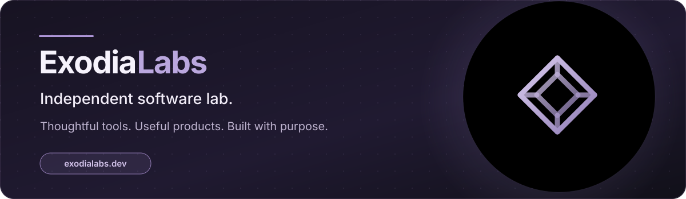
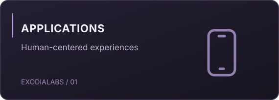
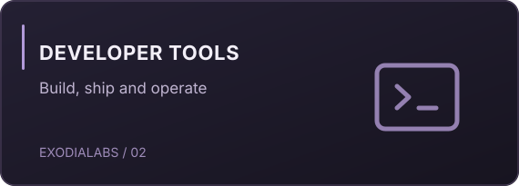
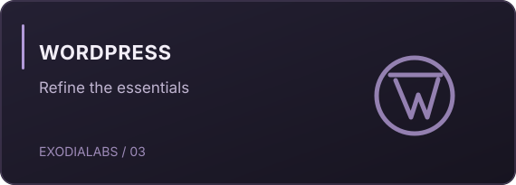
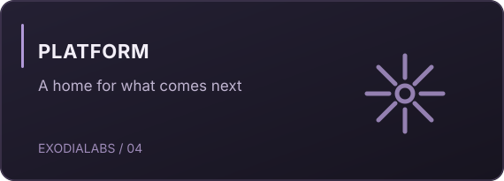

 

**Independent by nature. Purposeful by design.**

We build elegant, pragmatic software for people and developers — with quality, simplicity and long-term usefulness at the core.

[**Explore the website**](https://exodialabs.dev) &nbsp;·&nbsp; [**View repositories**](https://github.com/orgs/ExodiaLabs/repositories) &nbsp;·&nbsp; [**SignInForge on WordPress.org**](https://wordpress.org/plugins/signinforge/)

 

## What we build

<table>
<tr>
<td width="50%"></td>
<td width="50%"></td>
</tr>
<tr>
<td width="50%"></td>
<td width="50%"></td>
</tr>
</table>

## Selected work

| Product | Purpose | Availability |
| :--- | :--- | :--- |
| **[Exodock](https://github.com/ExodiaLabs/Exodock)** | A visual, keyboard-driven Docker administration console. | Public source · experimental |
| **[ExoPulse](https://github.com/ExodiaLabs/ExoPulse)** | Explore dependency health, technical debt and framework lifecycles across repositories. | Public source · experimental |
| **[SignInForge](https://wordpress.org/plugins/signinforge/)** | Customize WordPress authentication interfaces. | Available on WordPress.org |
| **MiaMiam** | A thoughtfully designed mobile companion for family life. | In development |
| **Exolane** | A visual Git and SVN desktop workspace. | Internal tooling |

> Our public repositories may include experimental software. Production readiness, release cadence and support vary by project.

## The way we work

**Useful by design** &nbsp; / &nbsp; **Simple by default** &nbsp; / &nbsp; **Built to last**

We believe good software should solve a real problem before adding complexity. We favour clear experiences, careful engineering and steady iteration over feature overload.

---

**ExodiaLabs** · Independent software lab

[exodialabs.dev](https://exodialabs.dev)

